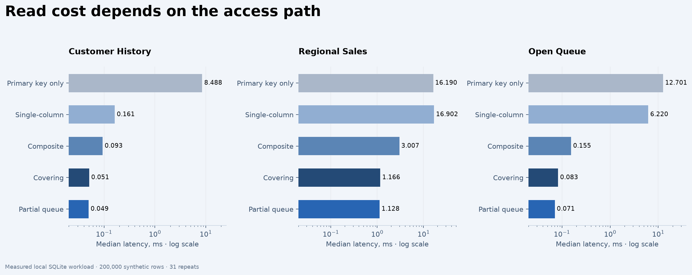
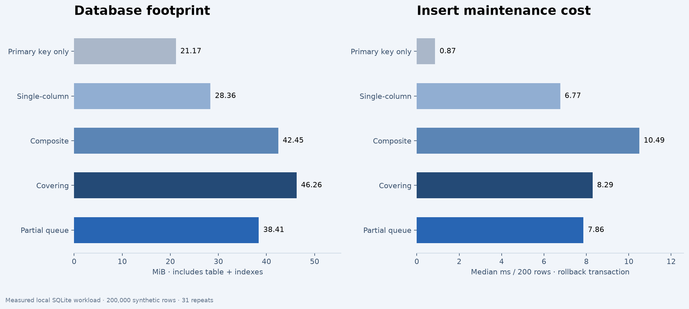

# SQLite index investigation

**[View the report in your browser](https://Michaelhoang8.github.io/sqlite-index-investigation/)**

An executable performance study of five index configurations over **200,000 synthetic orders**. It compares query latency, query plans, file size, insertion maintenance, and equivalent offset/keyset pagination results.



The measured regional-query median fell from **16.190 ms to 1.128 ms** between the primary-key baseline and the final suite. A region-only index did not improve that query. Replacing a full queue index with an open-only partial index saved **7.85 MiB** while retaining the other covering indexes. These are local warmed-cache observations, not production guarantees.

## Inspect the evidence

| Artifact | Contents |
|---|---|
| [Screenshot gallery](docs/screenshots/README.md) / [Recorded walkthrough](docs/recordings/README.md) | Actual browser captures and recorded review of the generated report |
| [Static visual report](docs/report.html) | Six sections covering results, plans, costs, pagination and method; download or serve locally to view |
| [Decision memo](docs/decision-memo.md) | Interpretation, proposed index choices, limits and next experiments |
| [Read summary](results/read_summary.csv) / [raw samples](results/read_timings.csv) | 465 actual read timings, medians and sample p95 |
| [Query plans](results/query_plans.json) | EXPLAIN QUERY PLAN output and bound parameters for all 15 combinations |
| [Index definitions](sql/index_suites.sql) / [query SQL](sql) | Reviewable query and index source |
| [Result checksums](results/result_checks.csv) | Exact result equality across configurations |
| [Insert timings](results/insert_timings.csv) / [storage](results/storage.csv) | Maintenance work and database footprint |
| [Pagination samples](results/pagination_timings.csv) / [checks](results/pagination_checks.json) | Equivalent-page timings, cursor values and plans |
| [Environment](results/environment.json) | Actual run time, versions, cache settings, seed and data checksum |
| [Workload source](src/investigation.py) / [sample input](data/sample_orders.csv) | Seeded generator, schema and 250 example records |
| [Tests](tests/test_investigation.py) | Index equivalence, sparse-ID pagination, rollback integrity and result reconciliation |

The project targets backend, infrastructure, database and performance-engineering skills: workload design, SQL indexing, planner interpretation, benchmark controls, correctness preservation and explicit tradeoffs.

## The experiment

| Configuration | Index design |
|---|---|
| `baseline` | INTEGER PRIMARY KEY only |
| `single_column` | Separate customer, region and status indexes |
| `composite` | Equality predicates followed by range/order columns |
| `covering` | Composite indexes extended with returned/aggregated columns |
| `partial` | Same customer/regional covering indexes; queue index contains open orders only |

Three fixed query patterns: the latest 25 orders for one customer, daily paid revenue in one region over the last 30 days, and the first 100 open orders within that window. Every query uses deterministic ordering and returns identical results under all configurations.

Each configuration starts from an identical database copy, runs `ANALYZE`, receives three warmups, then records 31 samples per query. Configuration order is seeded; query order is shuffled within repetitions. Read timers include execution plus fetching all rows. File sizes are recorded after index creation/analysis and before insertion trials.

**Insertion scope:** 200 inserts inside a transaction, followed by rollback outside the timer. This measures statement/index maintenance, **not committed transaction throughput**. The database row count is checked after rollback. `synchronous=FULL` is recorded, but no timed commit/fsync is performed.

**Pagination scope:** offset and keyset return the same 50 rows at four depths. Keyset receives an existing last-seen ID before timing. Cursor discovery is excluded because the experiment models sequential navigation; it does not make arbitrary page-number navigation equally cheap. Tests also cover deleted IDs.



## Reproduce

Python 3.13 was used for the checked-in run. The benchmark and tests use the standard library; Matplotlib/NumPy are needed only to render figures.

```sh
python -m venv .venv
# Windows PowerShell: .venv\Scripts\Activate.ps1
# macOS/Linux: source .venv/bin/activate
python -m pip install -r requirements.txt
python scripts/benchmark.py
python scripts/render_report.py
python -m unittest discover -s tests -v
```

The default benchmark regenerates the seeded workload and **overwrites the files in `results/`**. Timings will differ on another run or machine. Generated databases occupy roughly 240 MiB under ignored `.work/`; they are intentionally not committed. The source generator and sample are sufficient to reproduce them.

To preserve the published measurements while trying a smaller workload:

```sh
python scripts/benchmark.py --rows 12000 --repetitions 7 --warmups 2 --output results-ci
```

To view the static HTML report, open `docs/report.html` in a browser, or serve the repository and visit `http://localhost:8000/docs/report.html`:

```sh
python -m http.server 8000 --bind 127.0.0.1
```

CI verifies the published measurements, runs the correctness suite, executes a fresh smaller workload, and renders the committed measurements. It deliberately makes no timing-threshold assertion: scheduling noise should not turn a correct build red.

## Data and limitations

All records are fictional, generated with seed `81427`. One row represents an order; `amount_cents` is integer currency cents, timestamps are UTC ISO strings, and customer/region/status values are synthetic. There is no personal data or external database dependency. [Method and data dictionary](docs/method.md) describes the choices and missing production factors.

This is a single-process, warmed-cache study with fixed parameters. The OS cache is uncontrolled. Configuration order is seeded rather than counterbalanced. Results do not establish cold-disk behavior, concurrency behavior, customer-popularity skew, production p95 or real-business savings. Differences between suites with identical indexes can reflect noise and cache/order effects.

This is an AI-assisted portfolio project. Code and documentation were developed with assistance; the committed measurements were produced by actual local SQLite executions over explicitly synthetic inputs.
